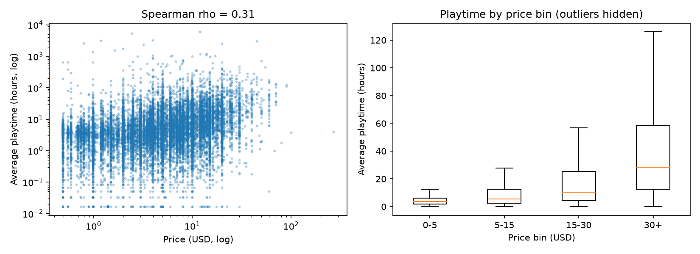

# 스팀 유료 게임의 가격과 평균 플레이 시간의 관계

작성자: 문영훈  
작성일: 2026-10-21  
과제: AI와 함께 쓰는 첫 논문 — 가설에서 결론까지

## 초록
게임 가격이 분량을 알려 주는 신호인지, 곧 비싼 게임일수록 오래 플레이되는지 알고 싶었다. 허깅페이스에 공개된 스팀 게임 데이터(124,146개)에서 유료이고, 리뷰가 100개 이상이며, 평균 플레이 시간이 0보다 큰 게임 16,911개를 골라 가격과 평균 플레이 시간의 스피어만 순위 상관을 계산했다. 상관계수는 0.306(중간 정도의 양의 상관)으로 사전에 정한 지지 조건을 충족했다. 가격대가 높을수록 평균 플레이 시간의 중앙값이 커졌다(5달러 이하 3.58시간, 30달러 초과 28.47시간). 그러나 같은 가격대 안의 차이가 크고, 리뷰 수 기준을 1개에서 1,000개로 올리면 상관이 0.267에서 0.444로 커져 결과의 크기가 표본 조건에 따라 달라졌다. 출시 연도와 리뷰 수를 통제하면 0.241로 낮아졌으나 양의 상관은 남았다. 이 결과는 상관이지 인과가 아니며, 사후 탐색 결과는 같은 데이터에서 나온 것이라 확증이 아니다.

## 1. 서론
게임 가격은 소비자가 구매 전에 가장 먼저 보는 정보다. 비싼 게임이 더 오래 즐길 거리를 제공하는지는 구매 판단에 쓸모 있는 질문이다. 반대로 가격과 플레이 시간이 무관하다면, 소비자는 가격을 분량의 신호로 믿기 어렵다. 이 연구는 공개된 스팀 게임 데이터로 이 질문을 확인한다.

## 2. 선행 연구와 이 연구의 위치
**이미 알려진 것.** Steam 데이터로 게임 사이의 플레이 시간을 비교한 대규모 연구가 있다(Sifa et al., 2015; O'Neill et al., 2016). 이용자의 플레이 시간과 지출은 소수에게 몰린 치우친 분포를 보인다. 한 연구는 상위 20% 이용자가 전체 플레이 시간의 82.4%를 차지한다고 보고했다(O'Neill et al., 2016). 플레이 패턴은 게임에 대한 만족과 관련된다고 알려져 있다(Heo & Park, 2021). 가격과 이용자 활동을 함께 다룬 연구도 있다(Aliev et al., 2025). 가격이 높을수록 보유자 수가 적다는 보고가 있으나 산점도를 눈으로 본 것이어서 통계 검정은 없다(Salkanović et al., 2024). 리뷰는 플레이 활동과 관련된다고 보고되었다(Brodschneider & Pirker, 2023).

**이 연구가 새로 주장하는 것.** 공개된 Steam 게임 데이터의 유료 게임에서 가격과 평균 플레이 시간 사이에 중간 정도의 양의 순위 상관이 있다는 점이다(결과는 5절). 확인한 범위에서는 가격과 평균 플레이 시간을 직접 비교한 선행 연구를 찾지 못했다. 이것이 새롭다는 뜻은 아니며, 검색 범위의 한계다. 선행 연구 조사는 분석을 끝낸 뒤에 했고, 이로 인해 가설과 분석 기준을 바꾸지 않았다.

## 3. 가설과 반증 조건
**가설:** 스팀의 유료 게임은 가격이 높을수록 평균 플레이 시간이 길다.

가격(원인)이 출시 이후 평균 플레이 시간(결과)에 영향을 준다는 방향의 가설이다. 데이터를 열기 전에 다음과 같이 반증 조건을 정했다. 스피어만 상관계수가 0 이하이거나, 양수여도 유의확률이 0.05 이상이면 가설을 기각한다. 분석 기준은 데이터를 열기 전에 문서로 작성해 날짜를 남겼고, 분석 후 바꾸지 않았다.

## 4. 방법
### 4.1 데이터
허깅페이스에 공개된 Steam Games Dataset(FronkonGames, n.d.; MIT 라이선스)의 `train-00000-of-00001.parquet` 파일을 2026-10-21에 내려받아 사용했다. 전체 124,146개 게임이 들어 있고 출시일 범위는 1997-06-30부터 2026-09-08까지다. 데이터 기준일은 제공처 문서에서 확인하지 못했고, 가장 늦은 출시일로 보아 2026년 9월 이후일 것으로 추정한다.

### 4.2 변수
- **가격:** `price` 열. 미국 달러로 가정했다. 정가인지 할인가인지는 확인하지 못했다.
- **평균 플레이 시간:** `average_playtime_forever` 열. 출시 이후 전체 평균이며, 분 단위로 가정하고 시간으로 환산했다.
- **리뷰 수:** `positive`와 `negative`의 합.
- **장르:** `genres` 열(한 게임이 여러 장르를 가질 수 있다).

### 4.3 분석 대상
다음 조건을 순서대로 적용했다. 조건과 100이라는 리뷰 수 기준은 데이터를 열기 전에 정했다.

| 단계 | 남은 게임 수 |
|---|---|
| 전체 | 124,146 |
| 가격 > 0 (유료 게임) | 97,734 |
| 리뷰 합계 >= 100 | 19,792 |
| 평균 플레이 시간 > 0 | 16,911 |

최종 분석 대상은 유료 게임의 약 17.3%다. 리뷰가 적은 게임은 평균 플레이 시간이 불안정해서 제외했다.

### 4.4 분석 방법
가격과 평균 플레이 시간의 스피어만 순위 상관계수와 유의확률을 계산했다. 두 변수 모두 한쪽으로 크게 치우친 분포라 순위 기반 방법을 택했다. 이용자 단위의 플레이 시간이 소수에게 몰려 있다는 보고(O'Neill et al., 2016)도 이 선택과 맞는다. 보조로 (1) 가격대 구간(0~5, 5~15, 15~30, 30 초과 달러)별 평균 플레이 시간의 중앙값과 평균, (2) 게임 수가 많은 상위 6개 장르별 상관을 계산했다. 효과 크기는 관례(|rho| 0.1 약함, 0.3 중간, 0.5 강함)로 해석했다. 모든 계산은 `analyze.py`로 수행했다.

### 4.5 설계 요약
이 연구는 조건을 직접 바꾸는 실험이 아니라 이미 공개된 자료를 분석하는 관찰 연구다. 그래서 "바꾸는 조건"은 게임마다 다르게 관찰되는 값이고, 나머지는 모두 고정했다.

| 구분 | 내용 |
|---|---|
| 관찰로 달라지는 값 | 게임의 가격(`price`) |
| 측정한 결과 값 | 평균 플레이 시간(`average_playtime_forever`, 시간으로 환산) |
| 고정한 조건 | 데이터 파일(`train-00000-of-00001.parquet`, 2026-10-21 내려받음), 포함 조건(가격 > 0, 리뷰 합계 100 이상, 평균 플레이 시간 > 0), 분석 방법(스피어만 순위 상관), 판정 기준(상관계수 > 0 이고 유의확률 < 0.05) |
| 표본 수 | 16,911개 게임(반복 대신 표본 수로 우연과 구분) |
| 원자료 | `analysis_sample.csv` (분석에 쓴 16,911행. 원본은 약 12만 4천 행이라 용량 때문에 분석에 쓴 행만 담고, 원본은 출처와 파일 해시로 안내) |
| 실행 절차 | `analyze.py` 한 번 실행(부록 A) |

시험 실행: 실제 데이터를 쓰기 전에 열 이름과 계산이 맞는지 확인하려고 무작위로 만든 가짜 표(약 3,000행)로 스크립트를 먼저 돌려 오류를 고쳤다. 가짜 표의 결과는 논문에 쓰지 않았다. 실제 데이터는 이 설계대로 한 번 실행했다.

### 4.6 결과 확인 방법
`analysis_sample.csv`가 있으면 아래 한 줄로 핵심 결과를 다시 계산할 수 있다. 행 수는 16,911, 상관계수는 약 0.306이 나와야 한다.

```
python -c "import pandas as pd; from scipy.stats import spearmanr; d=pd.read_csv('analysis_sample.csv'); print(len(d), spearmanr(d['price'], d['average_playtime_hours']))"
```

원본 파일로 전체 과정을 다시 하려면 `analyze.py`를 실행하고, 출력된 원본 파일 SHA-256이 `results_summary.txt`에 적힌 값과 같은지 확인한다.

## 5. 결과
### 5.1 전체 상관
가격과 평균 플레이 시간의 스피어만 상관계수는 **0.306**이었다(n = 16,911). 유의확률은 계산 프로그램이 0으로 표시했는데, 이는 값이 너무 작아 0으로 처리된 것이므로 "매우 작다"고 해석한다. 표본이 크면 작은 상관도 유의해지므로 해석은 상관계수 크기를 중심으로 한다. 상관계수가 0보다 크고 유의확률이 0.05보다 작아 사전에 정한 지지 조건을 충족했다.

### 5.2 가격대별 평균 플레이 시간

| 가격대(달러) | 게임 수 | 중앙값(시간) | 평균(시간) |
|---|---|---|---|
| 0~5 | 9,789 | 3.58 | 10.19 |
| 5~15 | 5,616 | 5.53 | 15.49 |
| 15~30 | 1,321 | 10.50 | 28.74 |
| 30 초과 | 185 | 28.47 | 67.84 |

가격대가 높아질수록 중앙값과 평균이 모두 커졌다. 30달러 초과 구간의 중앙값은 5달러 이하 구간의 약 8배다. 모든 구간에서 평균이 중앙값보다 크다. 일부 게임에서 플레이 시간이 매우 긴 쪽으로 분포가 치우쳐 있다는 뜻이다. 30달러 초과 구간은 게임이 185개로 적어 해석에 주의가 필요하다.



*그림 1. 왼쪽: 가격과 평균 플레이 시간의 산점도(양쪽 로그 눈금). 오른쪽: 가격대별 평균 플레이 시간의 상자 그림(극단값은 생략).*

### 5.3 장르별 상관

| 장르 | 게임 수 | 상관계수 |
|---|---|---|
| Indie | 11,083 | 0.241 |
| Action | 7,352 | 0.285 |
| Adventure | 7,349 | 0.288 |
| Casual | 4,970 | 0.250 |
| Simulation | 4,277 | 0.314 |
| RPG | 4,032 | 0.305 |

여섯 장르 모두 양의 상관이 나왔고 값은 0.241~0.314 범위였다. 한 게임이 여러 장르에 속할 수 있어 장르별 표본은 서로 겹친다.

### 5.4 사후 탐색: 가설과 다르게 보이는 부분 확인
이 절의 분석은 주 분석을 끝낸 뒤에 추가한 것이며 사전 기준에 없다(`explore.py`). 주 분석의 판정(5.1)은 바꾸지 않는다.

**가설과 같게 나온 부분.** 아래 모든 분석에서 상관이 양(+)이었다. 가격이 높을수록 플레이 시간이 길다는 방향은 어느 조건에서도 뒤집히지 않았다.

**가설과 다르게 나온 부분.** 상관의 크기가 조건에 따라 크게 달랐고, 같은 가격대 안의 차이도 컸다.

**(A) 리뷰 수 기준을 바꿨을 때**

| 리뷰 수 기준 | 게임 수 | 상관계수 |
|---|---|---|
| 1개 이상 | 21,578 | 0.267 |
| 50개 이상 | 19,415 | 0.282 |
| 100개 이상 (주 분석) | 16,911 | 0.306 |
| 200개 이상 | 13,575 | 0.342 |
| 500개 이상 | 8,926 | 0.409 |
| 1,000개 이상 | 6,129 | 0.444 |

**(B) 출시 시기별**

| 출시 시기 | 게임 수 | 상관계수 |
|---|---|---|
| 2014년 이전 | 2,482 | 0.193 |
| 2015~2018 | 5,519 | 0.233 |
| 2019~2022 | 4,998 | 0.361 |
| 2023년 이후 | 3,912 | 0.384 |

**(C) 출시 연도와 리뷰 수를 통제한 편 스피어만 상관:** 0.241 (n = 16,911).

**(D) 가격대 안의 흩어짐 (평균 플레이 시간, 시간)**

| 가격대(달러) | 25% | 50%(중앙값) | 75% | 25%~75% 폭 |
|---|---|---|---|---|
| 0~5 | 1.85 | 3.58 | 6.17 | 4.32 |
| 5~15 | 2.48 | 5.53 | 12.62 | 10.14 |
| 15~30 | 4.15 | 10.50 | 25.28 | 21.13 |
| 30 초과 | 12.38 | 28.47 | 58.43 | 46.05 |

**(E) 멀티플레이 요소 유무별:** 있음 0.315 (n = 4,510), 없음 0.292 (n = 12,401). `categories` 열에 "multi-player"가 들어 있는지로 나누었다.

## 6. 논의
### 6.1 해석
가설은 이 데이터에서 지지되었다. 가격이 높은 게임이 평균적으로 더 오래 플레이되는 경향이 있다. 그러나 상관의 크기는 하나의 값으로 말하기 어렵다. 주 분석에서 0.306이었지만 리뷰 수 기준에 따라 0.267에서 0.444까지 움직였다. 또 같은 가격대 안에서도 플레이 시간이 크게 갈렸다. 30달러 초과 게임의 25%~75% 구간은 12.38~58.43시간이고, 이는 15~30달러 게임의 중앙값(10.50시간)보다 위쪽이다. 반면 5~15달러 게임의 중앙값(5.53시간)은 5달러 이하 게임의 75% 지점(6.17시간)에 가깝다. 가격은 집단의 경향을 말해 주지만 개별 게임의 플레이 시간을 예측하기에는 부족하다.

### 6.2 가설과 다르게 나온 부분의 이유 검토
상관의 크기가 조건에 따라 달라진 이유로 다음을 검토했다.

1. **인기 게임 편향.** 리뷰 수 기준을 올려 인기 게임 쪽으로 표본을 좁힐수록 상관이 커졌다(0.267 → 0.444). 이 설명과 데이터가 맞는다. 리뷰가 적은 게임에서는 가격과 플레이 시간의 관계가 약하거나, 평균 플레이 시간이 불안정해서 관계가 흐려졌을 수 있다. 어느 쪽인지는 이 데이터로 가를 수 없다.
2. **출시 시기.** 출시 연도와 리뷰 수를 통제하자 상관이 0.306에서 0.241로 낮아졌다. 이 요인들이 상관의 일부를 설명하지만 전부는 아니다. 한편 출시 시기별 상관은 오래된 게임(0.193)보다 최근 게임(0.384)에서 컸다. 그 이유는 이 데이터로 확인하지 못했다.
3. **멀티플레이 요소.** 있음 0.315, 없음 0.292로 차이가 작다. 멀티플레이 요소가 상관을 만든다는 설명은 이 데이터에서 지지되지 않았다.

이 밖에 분량이 많은 게임을 만드는 데 비용이 더 들어 가격과 플레이 시간이 함께 높아질 수 있다는 설명이 가능하지만, 이 데이터에는 게임 분량을 나타내는 값이 없어 확인하지 못했다.

### 6.3 가설을 고친 과정
- **고치기 전(사전 가설):** 스팀의 유료 게임은 가격이 높을수록 평균 플레이 시간이 길다.
- **고친 후(사후 가설):** 스팀의 유료 게임에서 가격과 평균 플레이 시간 사이에는 양의 상관이 있으며, 리뷰 수 기준을 높여 인기 게임 쪽으로 표본을 좁힐수록 그 상관이 더 강하다.

고친 가설은 같은 데이터를 본 뒤에 만든 것이다. 그래서 이 데이터로 검증된 것이 아니며, 다른 데이터나 다른 시점의 자료로 다시 시험해야 한다. 사전 가설의 판정은 그대로 유지한다.

### 한계
1. **상관이지 인과가 아니다.** 출시 연도와 리뷰 수는 통제했으나(편 상관 0.241) 게임 분량, 장르, 온라인 요소 등은 통제하지 않았다.
2. **선택 편향과 기준 민감성.** 유료 게임의 약 17%만 분석했다. 리뷰 100개 이상이라는 기준은 사전에 임의로 정한 값이고, 결과의 크기는 이 기준에 민감하다(0.267~0.444). 리뷰가 플레이 활동과 관련된다는 보고(Brodschneider & Pirker, 2023)도 있어서, 리뷰 수로 표본을 거른 것이 결과에 영향을 주었을 수 있다. 어느 기준이 맞는지는 말할 수 없다.
3. **측정 가정.** 가격은 달러, 플레이 시간은 분 단위라고 가정했고 제공처 문서에서 확인하지 못했다. 가격이 정가인지 할인가인지도 모른다.
4. **평균의 한계.** 평균 플레이 시간은 소수의 장시간 이용자에 크게 영향받을 수 있다. 평균이 중앙값보다 큰 것이 이를 보여 준다. 그래서 순위 상관을 썼다.
5. **장르 중복과 다중 비교.** 한 게임이 여러 장르에 포함되어 장르별 결과는 독립적이지 않다. 장르별 여섯 번, 사후 탐색 여러 번의 비교를 했지만 별도의 보정은 하지 않았다.
6. **사후 탐색의 성격.** 5.4절의 분석은 주 분석 뒤에 같은 데이터로 추가한 것이다. 편 상관은 순위로 바꾼 값의 잔차 상관이며 유의확률과 신뢰구간은 계산하지 않았다. 멀티플레이 구분은 `categories` 열의 글자 포함 여부로 했다.
7. **데이터 기준일.** 정확한 수집 시점을 확인하지 못했다.

## 7. 결론
스팀 유료 게임에서 가격과 평균 플레이 시간은 양의 상관을 보였다. 사전에 정한 기준(리뷰 100개 이상)으로는 스피어만 상관계수가 0.306(n = 16,911)이었고, 가격대가 높을수록 평균 플레이 시간의 중앙값이 컸다(5달러 이하 3.58시간, 30달러 초과 28.47시간). 사전 가설은 지지되었다.

다만 이 상관은 크기가 일정하지 않았다. 리뷰 수 기준을 1개에서 1,000개로 올리면 상관이 0.267에서 0.444로 커졌고, 출시 연도와 리뷰 수를 통제하면 0.241로 낮아졌지만 사라지지는 않았다. 같은 가격대 안에서도 플레이 시간이 크게 갈려서, 가격은 개별 게임의 플레이 시간을 예측하기에는 부족했다. 멀티플레이 요소 유무는 상관을 크게 바꾸지 않았다(0.315, 0.292).

이 연구로는 가격이 플레이 시간의 원인이라고 말할 수 없고, 리뷰가 적은 게임이나 데이터에 없는 게임에 같은 결과가 나온다고도 말할 수 없다. 사후에 고친 가설(인기 게임일수록 상관이 강하다)은 같은 데이터에서 나온 것이어서 다른 자료로 확인해야 한다. 후속 연구에서는 같은 게임의 가격 변화 전후를 비교하거나 게임 분량을 나타내는 값을 포함할 수 있다.

## 참고문헌

Aliev, A. R., Aliyev, T. A., & Eyniyev, R. (2025). Analyzing price dynamics, activity of players and reviews of popular indie games on Steam post-COVID-19 pandemic using SteamDB. *International Journal of Information Technology and Computer Science, 17*(3), 26–51. https://doi.org/10.5815/ijitcs.2025.03.03

Brodschneider, V., & Pirker, J. (2023). On the influence of reviews on play activity on Steam: A statistical approach. In *Proceedings of the 2023 IEEE Conference on Games (CoG 2023)*. IEEE. https://doi.org/10.1109/CoG57401.2023.10333235

FronkonGames. (n.d.). *Steam games dataset* [Data set]. Hugging Face. https://huggingface.co/datasets/FronkonGames/steam-games-dataset (DOI: 10.57967/hf/0511)

Heo, S. P., & Park, J. H. (2021). Are you satisfied or satiated by the games you play? An empirical study about game play and purchase patterns by genres. *Telematics and Informatics, 59*, Article 101550. https://doi.org/10.1016/j.tele.2020.101550

O'Neill, M., Vaziripour, E., Wu, J., & Zappala, D. (2016). Condensing Steam: Distilling the diversity of gamer behavior. In *Proceedings of the ACM Internet Measurement Conference (IMC 2016)*. ACM. https://zappala.byu.edu/pubs/steam-imc-2016.pdf

Salkanović, E., Zukorlić, N., Oković, L., & Kečo, D. (2024). A data analysis of Steam's game catalog and diverse recommendation strategies. *International Journal of Computer Applications, 186*(54), 39–49. https://www.ijcaonline.org/archives/volume186/number54/salkanovic-2024-ijca-924261.pdf

Sifa, R., Drachen, A., & Bauckhage, C. (2015). Large-scale cross-game player behavior analysis on Steam. *Proceedings of the AAAI Conference on Artificial Intelligence and Interactive Digital Entertainment, 11*(1), 198–204. https://doi.org/10.1609/aiide.v11i1.12804

## 부록 A. 재현 방법
1. 허깅페이스 Steam Games Dataset의 `data/train-00000-of-00001.parquet`를 내려받아 `analyze.py`와 같은 폴더에 둔다.
2. `pip install pandas pyarrow scipy matplotlib`로 필요한 도구를 설치한다.
3. `python analyze.py`를 실행하면 `results_summary.txt`, `bin_table.csv`, `genre_table.csv`, `result.png`, `analysis_sample.csv`가 만들어진다.
4. 사후 탐색은 같은 폴더에서 `python explore.py`를 실행한다. `explore_results.txt`, `explore_table.csv`가 만들어진다.

재현 패키지(ZIP)에는 `analyze.py`, `explore.py`, 위 결과 파일 일곱 개, `과제10_사전기준.md`, `과제10_참고문헌.md`, `README.md`를 넣는다. 원본 데이터(약 12만 4천 행)는 용량 때문에 넣지 않고 출처 주소, 파일 이름, 행 수, SHA-256으로 안내한다.

분석 기준(포함 조건, 가격대 구간, 지지 조건)은 `analyze.py` 맨 위에 상수로 고정되어 있으며, 사전 기준 문서와 같다.

## 부록 B. 변경 이력
데이터를 열기 전에 정한 분석 기준(포함 조건, 가격대 구간, 판정 기준)을 분석 후에 바꾼 곳은 없다.
- 주제는 데이터 분석 전에 세 번 바꿨다(연패 후 재시작 지연, 방송 제목 길이, 스팀 가격). 이유는 `과제10_사전기준.md` 3절에 있다. 앞의 두 주제는 분석에 쓸 데이터를 얻기 전에 접었다.
- `analyze.py`는 실제 데이터를 쓰기 전에 두 번 고쳤다(CSV도 읽고 열 이름을 자동으로 맞추게 함, 분석에 쓴 원자료를 파일로 저장하고 원본 해시를 출력하게 함). 분석 기준은 건드리지 않았다.
- 선행 연구 조사(2절과 참고문헌)는 분석 후에 추가했다.
- 주 분석 뒤에 사후 탐색(`explore.py`, 5.4절)을 추가했고, 그 결과를 보고 사후 가설을 하나 만들었다(6.3절). 사전 가설과 주 분석의 판정은 바꾸지 않았다.
